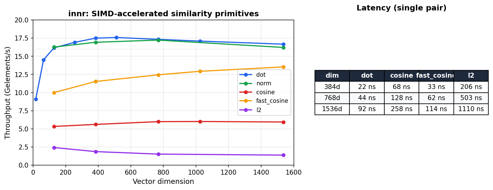

# innr

[](https://crates.io/crates/innr)
[](https://docs.rs/innr)
[](https://github.com/arclabs561/innr/actions/workflows/ci.yml)

SIMD-accelerated vector similarity primitives.

## Quickstart

```toml
[dependencies]
innr = "0.6.3"
```

The published 0.6.3 dispatches with its own `std::arch` kernels, has no
`simd` feature, and declares Rust 1.89. The rest of this README
describes the unreleased source checkout, which differs as follows.

The default `simd` feature uses `pulp` for safe runtime-dispatched kernels.
Set `default-features = false` for dependency-free portable kernels. The
checkout pins Pulp to git commit `601de0c071ba32df3fd7ff33fc4218c9bd712aba`
(which uses `pastey`), so it cannot be published to crates.io as is. innr
forbids unsafe code in its own source; Pulp uses unsafe code internally
behind its safe API.

```rust
use innr::{dot, cosine, norm};

let a = [1.0_f32, 0.0, 0.0];
let b = [0.707, 0.707, 0.0];

let d = dot(&a, &b);
let c = cosine(&a, &b);
let n = norm(&a);
assert!((d - 0.707).abs() < 1e-6);
assert!((c - 0.707107).abs() < 1e-6);
assert_eq!(n, 1.0);
```

### Batch search

```rust
use innr::batch::{VerticalBatch, batch_knn_dot};

// 4 vectors of dimension 3
let corpus = vec![
    vec![1.0f32, 0.0, 0.0],
    vec![0.0, 1.0, 0.0],
    vec![0.7, 0.7, 0.0],
    vec![0.0, 0.0, 1.0],
];
let batch = VerticalBatch::from_rows(&corpus);

let query = [0.8f32, 0.6, 0.0];
let result = batch_knn_dot(&query, &batch, 2);
assert_eq!(result.indices, vec![2, 0]);
assert!((result.scores[0] - 0.98).abs() < 1e-6);
```

## API

The [API reference](https://docs.rs/innr) covers dense and sparse similarity,
quantization, batch search, and late interaction. SIMD and portable paths may
differ in floating-point rounding.

**Metric trait**: `distance::Distance` with zero-sized metrics `DistCosine`, `DistDot`, `DistL2`, `DistL1`, `DistHamming`, `DistSlotU32` for parameterizing generic indexes. With the optional `anndists` feature these also implement `anndists::dist::Distance`, so they work directly as `hnsw_rs` distances:

```toml
innr = { version = "0.6.3", features = ["anndists"] }
```

```rust
use hnsw_rs::prelude::Hnsw;
use innr::distance::DistSlotU32;

// HNSW over u32 MinHash sketches, innr's slot Hamming as the metric.
let index = Hnsw::<u32, DistSlotU32>::new(16, 10_000, 16, 200, DistSlotU32);
```

## SIMD Dispatch

| Architecture | Instructions | Detection |
|--------------|--------------|-----------|
| x86_64 | x86-64-v4 (Pulp V4, including AVX-512) | Runtime |
| x86_64 | x86-64-v3 (Pulp V3, including AVX2 + FMA) | Runtime |
| aarch64 | NEON | Always |
| Other | Portable | LLVM auto-vec |

Short vectors use portable code (threshold 16 dims for dense f32, 32 for quantized u8, 8 for integer slots). This development branch requires Rust 1.94 for the pinned Pulp backend's x86 intrinsics.

## Performance



*Cache-resident, single-core criterion runs of innr 0.1.5 on Apple Silicon
(NEON), transcribed into `scripts/plot_benchmarks.py`. They predate the Pulp
backend; run `cargo bench` for current numbers on your hardware.*

Results depend on the CPU, compiler, vector length, and memory behavior.
AVX-512 paths are executed and differential-tested in CI under Intel SDE.

For maximum performance, build with native CPU features:

```bash
RUSTFLAGS="-C target-cpu=native" cargo build --release
```

Run benchmarks:

```bash
cargo bench
```

## Examples

[**01_basic_ops.rs**](examples/01_basic_ops.rs): Core similarity metrics and their mathematical relationships. Proves `L2^2(a,b) = 2(1 - cosine(a,b))` for normalized vectors.

[**batch_demo.rs**](examples/batch_demo.rs): PDX-style columnar layout for batch retrieval. Transposes 10K vectors (128d), runs 100 queries, verifies k-NN against brute-force.

[**binary_demo.rs**](examples/binary_demo.rs): Binary quantization for first-stage retrieval. 32x memory reduction, measures recall@10 against full-precision search.

More in [`examples/`](examples/):

[**matryoshka_search.rs**](examples/matryoshka_search.rs): MRL progressive search: a coarse pass on a 128d prefix, then a fine pass at full 768d, the cheap-then-precise pattern for large indexes.

[**maxsim_colbert.rs**](examples/maxsim_colbert.rs): ColBERT-style MaxSim late interaction, the per-token scoring multi-vector rerankers use.

[**ternary_demo.rs**](examples/ternary_demo.rs): ternary quantization in a packed 2-bit representation, with local timing and ranking comparisons.

## Tests

```bash
cargo test -p innr
```

## License

Dual-licensed under MIT or Apache-2.0.
